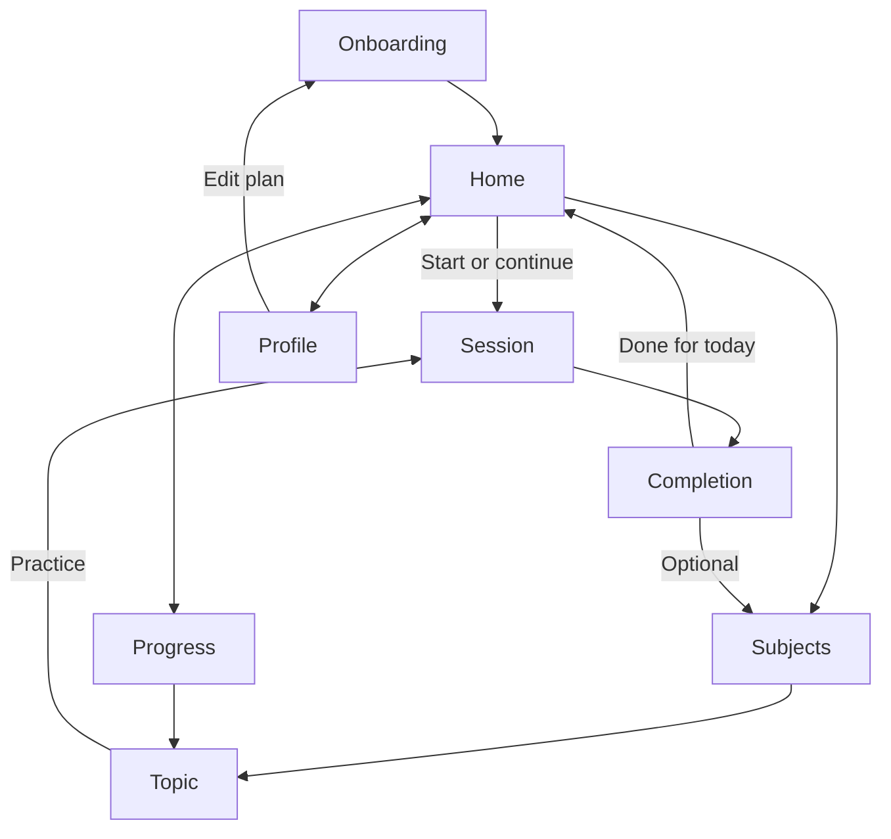

# Memmara — product and implementation handoff

## Product decision

Make the learning session the centre of the experience. The home screen is a small invitation: a bounded plan, a reason for the next review and one clear action. The visual direction is quiet ink, warm violet and restrained cyan, with generous space around the question. A weekly consistency target makes room for rest. Completion is a destination, not a prompt to keep consuming.

The user has chosen to build self-checking into the question data. The practice flow gives an initial bounded rule result, then reveals the mark scheme and model answer on request. The student can revise the response, award marks, and challenge a specific criterion. Preserve the original response and rule result separately from post-reveal changes. The supplied bank has free-text schemes, so this prototype asks for a total self-awarded score and a free-text criterion challenge; the new bank should provide atomic criteria.

## Journey

| Moment | Student need | Implemented response |
|---|---|---|
| First visit | Get started quickly | Three steps: course/tier, studied topics, manageable daily goal |
| Arrival | Know what to do | Daily Mix card with bounded count, approximate time and reason |
| Retrieval | Space to think | One written response, hint optional, no countdown |
| Feedback | Understand the result | Explicit outcome, explanation, missing pieces, model and rubric |
| Mistake | Know what comes next | Different question for the same concept later when a slot exists; future review |
| Interruption | Avoid losing work | Draft and state saved locally; Continue my mix |
| Completion | Feel finished | Questions, participation XP, concepts revisited, Done for today |
| Return | Restart without guilt | Welcome back copy and a short refresh |

## Screen deliverables

`memmara/public/design.html` contains seven mobile wireframes and responsive live-frame presentations. The deployed application is the high-fidelity interactive mobile and desktop design; it uses the same components and tokens rather than disconnected static mocks. At 600px navigation moves to the bottom; at 850px the sidebar compresses; wide screens retain the same information architecture. Use the live application for actual session states and theme previews.

### Home hierarchy

Greeting → weekly consistency → Daily Mix (primary) → choose a topic (secondary) → two studied topics → one useful learning insight. The completed state replaces the invitation with closure. XP lives in Progress and completion, not as a competing home widget.

### Answer and feedback hierarchy

Small topic context → reason for practice → large question → labelled text input → Check answer → I’m not sure yet. Calculations ask for units and allow working. After submission: outcome → explanation → missing items → model → optional common misconception and rubric → Continue. Reports are local, exportable, and explicitly not sent to a teacher yet.

## Navigation



## Session state machine

```mermaid
stateDiagram-v2
    [*] --> ready
    ready --> answering: Begin
    answering --> submitted: Check answer / not sure
    submitted --> feedback: Marking result persisted
    submitted --> answering: Failure; retain draft
    feedback --> next: Continue
    next --> answering: Advance to next unique question
    feedback --> complete: Final answer
    complete --> [*]: Done for today
```



Persist a single progress envelope locally. Each answer has `sessionId:index` as its idempotency identity. Refresh during `submitted` or `next` restores feedback if an attempt exists, otherwise answering. XP is derived from unique event IDs and one question award per day; the daily completion award is capped once per calendar day. Production must move these guarantees into database transactions and unique constraints.

## Component hierarchy

```text
App / content loader / persistence boundary
  AppShell
    Sidebar | MobileNavigation
    Topbar / OfflineBanner / StorageWarning / Toast
  Onboarding
    CourseSelector / TierSelector / StudiedTopics / GoalCards
  Home
    DailyMixCard / OrbitIllustration / WeeklyRhythm / TopicCard
  Subjects / TopicDetail
    TopicCard / SubtopicEvidence / PracticeAction
  SessionController
    SessionProgress / ReadyScreen
    QuestionContext / AnswerInput / Hint
    Feedback / MissingEvidence / ModelAnswer / Rubric / ReportForm
    Completion / UsefulnessPrompt
  Progress
    Coverage / Retention / Participation / Achievements
  Profile
    Plan / Theme / OptionalExamDate / Export / DemoControls
```

The prototype keeps screen composition in `main.tsx` for readability in one deliverable. Extract the named screen components as the team grows; business rules and content contracts are already separate modules.

## Design tokens

| Token | Dark | Light | Purpose |
|---|---|---|---|
| background | #10121E | #F7F7FB | Page |
| surface | #191C2B | #FFFFFF | Cards |
| text | #F1F2FA | #202339 | Main reading |
| muted | #A4A9BE | #5C6175 | Supporting text |
| violet action | #BCA8FF | #7053B2 | Primary action |
| cyan | #8BDBDC | #20777D | Subject/learning accent |
| gold | #E7C681 | #81601C | Meaningful completion |
| orange | #F7B482 | #9B4C1B | Consistency |

System sans typography avoids remote font dependencies. Headings: 24–40px; question: 24–29px; answer: 14–15px. Minimum action target 44px. Corners 9px controls, 13–20px cards. Use explicit text for outcomes, visible focus, semantic form labels, live feedback and reduced-motion media query. Secondary microcopy is deliberately compact; conduct accessibility review and reading-size testing with students before release. Optional sound/haptics are absent, so there is no unexpected audio.

## Data contract and curriculum integration

Keep every original question field unchanged. Runtime validation requires unique IDs, allowed enum values, nonempty content, misconception arrays and a valid curriculum reference. Original `specification_point_id` values are AQA numerical references. Resolve them through `CurriculumPoint.spec_reference` to the platform point identifier; attempts and schedules use that platform ID. Never silently reinterpret or overwrite source IDs. Render topic/subtopic names, never codes, in the learner UI.

Typed models are in `memmara/src/models.ts`: Question, CurriculumPoint, Settings, Attempt, MarkingResult, ReviewSchedule, MasteryEvidence, Session, XPEvent, Achievement, Report, Progress and MarkingProvider. Content files are independent of local progress. Extend settings to arrays of course selections when other subjects are actually available. Add board-specific mappings as versioned curriculum mappings, not guesses based on similar topic names.

The earlier curriculum file is **not a verified inventory of every atomic assessable statement**. Its records are mostly numbered subsections. Coverage displays mean imported records practised, not complete GCSE exam coverage. Before production: audit source/specification versions, split composite outcomes, independently validate tier tags, identify missing bank coverage and keep an explicit mapping provenance. The bank is unmodified and should receive examiner review separately from software import validation.

## Automatic marking policy

1. Explicit authored answer variants and known wrong answers for starting energy-store questions.
2. Anchored numeric final-answer parsing with a bounded dimension/unit conversion registry. Equivalent supported units accepted; mismatched/missing units flagged; incorrect numeric values identify final-answer mismatch. No claims about method marks.
3. Complete normalised reference answer matches accepted. This is not keyword scoring.
4. Unfamiliar prose, unsupported units or ambiguous working are **not auto-marked**. The learner can compare with the model answer and mark scheme; the answer is excluded from retention success/failure until self-assessed.

The learner can mark each authored criterion as correct after revealing the mark scheme, revise their answer, and save a challenge on-device. Rules have a version in every result. The AI adapter is ready for a same-origin authenticated endpoint and validates response shape. There is no live AI service or hidden API key. A production server can load the trusted rubric by question ID, validate content versions, evaluate structured criteria and store evidence and confidence. Uncertain answers remain unmarked by automatic rules for the learner to compare against the scheme.

## Scheduling and honest mastery

After initial feedback, the learner opens the mark scheme to compare and revise their work. The learner can mark criteria as correct, save a self-awarded score and record a challenge reason locally. Each self-check is appended; it does not overwrite the original response or automatic rule result. Challenges are not sent to a person for checking. Post-reveal answers and self-awarded marks are not independent recall evidence.

Selection order: due studied concepts, recent difficulties, less-practised studied concepts, opted-in new content. Within priority, prefer unused/older questions and vary recent concepts. Topic selection is an explicit opt-in for that practice session. Normal mixes never silently introduce unstudied topics. Session length stays fixed; a later slot may be replaced with a different same-concept question after a difficulty. If there is no later slot or alternate question, schedule a future review.

Prototype intervals: typically one day after a new response or difficulty; increase to a bounded 3–14-day interval for later independent successes. These are product heuristics, not a calibrated spaced-repetition algorithm. Secure requires successful independent recall on three separate delayed practice days. Immediate correction, hints and pending marking do not establish secure retention. Review due is independent from mastery state. XP represents participation and is capped; no ability leaderboard or locked topic path.

## Production schema alignment

| Front-end model | Existing PostgreSQL target |
|---|---|
| Question + original ID | questions.source_system + source_question_id; versioned content |
| Curriculum adapter | specification_points + question_specification_points |
| Session | daily_mix_sessions + ordered session items (add persistent planned IDs) |
| Attempt / marking | student_question_attempts + versioned marking result audit |
| Authored self-check rubric | mark_schemes + mark_scheme_criteria in `self_check_schema.sql` |
| Post-reveal answer changes | `attempt_response_revisions` append-only rows |
| Student scores and criterion challenges | `attempt_self_checks`, `attempt_self_check_criteria`, `mark_scheme_challenges` |
| ReviewSchedule | retrieval_schedules |
| MasteryEvidence | mastery_scores backed by attempts, algorithm version |
| Settings | student subject/course enrolments and preference rows |
| XP / reports | add append-only reward events, review reports and resolution tables |

Do not use a client-side answer key for a graded or adversarial assessment. Serve learner question payloads without answers; mark on the server. Use authenticated tenant-scoped access, transactionally enforced idempotency, server timestamps, content snapshots, and append-only grading revisions. The prior SQL files are a foundation, not an already connected production database.

## Prioritised React and backend plan

**P0 — done in prototype:** complete daily loop, source bank integration, safe tier filters, bounded rule results, persistent drafts, fixed-length retries, completion, topic/progress UI, both themes, post-mark-scheme revisions, self-awarded scores and local criterion challenges.

**P0 — before student pilot:** replace free-text schemes with examiner-authored atomic criteria; validate per-criterion self-mark logic and totals; audit curriculum/tier accuracy; production account/session storage; server idempotency and permissions; accessibility and age-appropriate usability checks; content version migration and retention policy.

**P1:** rubric-based AI adapter with offline evaluation, confidence calibration and disagreement handling; strengthen storage with database transactions and per-tenant authorisation; validated scheduling, multi-subject mixing, optional notifications with real opt-in and chosen local times.

**P2:** teacher/class workflows, school and MAT aggregates with appropriate disclosure controls, validated exam-board mappings, MIS import reconciliation and exports, production diagnostics and account recovery. Aggregate anonymised analytics without leaking individual learning records across schools.

## Acceptance walkthrough and measures

Use the route in README to explore correct, incorrect, unknown wording, non-recall, pause/resume, fixed completion and return preview. The prototype uses a fictional Alex profile; it collects no email, school or birth date. Reports and usefulness feedback stay local and are exportable. Loading/error/offline and empty-eligibility messages are explicit. No remote tracking has been enabled.

Future metrics: session_started/completed (bounded completion rate), return_visit after days away, independent_delayed_attempt (by content/version and hint use), usefulness/helpfulness feedback, frustration, marking_review_requested and resolved (including reversal rate). Define retention cohorts and denominators before displaying percentages. Avoid optimising duration or raw XP alone. Keep sensitive free-text responses out of general event analytics.
